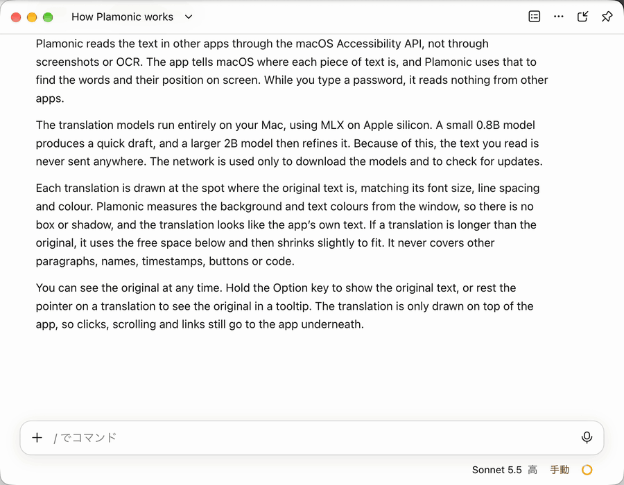

<div align="center">

# Plamonic

**Read any Mac app in your language, right where it is.**

Plamonic is a menu bar app that draws translations over the text of other apps, so they read as if they had been
written in your language.<br>
Translation runs on your Mac with PLaMo 3 Translate, so the text never leaves it.

[](https://github.com/sizumita/Plamonic/releases/latest)


[](LICENSE)

[日本語](README.md) | English



</div>

> [!NOTE]
> The app's interface is in Japanese. Translations can go into 53 languages.

## What it does

### Blends into the app

Each translation is drawn where the original is, in the original's font size, line spacing and colour. Plamonic
measures the background and text colours from the window itself, so there is no box or shadow: the translation looks
like the app's own text. When a translation is longer than the original, it uses the free space below and then shrinks
slightly to fit. It never covers other paragraphs, names, timestamps, buttons or code.

### Works like the app

The translation is only drawn on top, so clicks and scrolling still go to the app. Links inside a translation work,
and right-clicking one opens the app's own menu, such as Copy Link Address.

### The original is one key away

Hold ⌥ (Option) to see the original. Rest the pointer on a translation to see its original in a tooltip.

### Stays on your Mac

Plamonic reads text from apps through the macOS Accessibility API, not from screenshots or OCR. The models run on
your Mac with [MLX](https://github.com/ml-explore/mlx-swift), so nothing you read is sent anywhere. While you type a
password, Plamonic reads nothing.

### Knows what to translate in each app

In Slack and Discord it translates message text only; in a terminal, the output without borders and prompts. You can
also translate the whole window, just the paragraph under the pointer, or just the selected text.

### And more

- 53 target languages, plus easy Japanese (やさしい日本語), in plain or polite style.
- A glossary for names and terms you want translated your way.
- Per-app modes: automatic (translate whenever the screen changes), manual (translate on a hotkey) or off.
- Updates are announced in the menu and install from there.

## Supported apps

| | App | What is translated |
| :---: | --- | --- |
| ✅ | Slack | Message text |
| ✅ | Discord | Message text and embed descriptions |
| ✅ | Claude (Claude Code tab) | Chat messages |
| ✅ | OpenCode (desktop) | Body paragraphs |
| ✅ | Terminal | Output, for example from the Claude Code, Codex and OpenCode CLIs |
| 🟡 | iTerm2 | Output, the same way as Terminal |
| 🟡 | Codex (desktop) | Chat messages |
| 🟡 | DeepSeek Harness | Chat messages |
| ❌ | Ghostty | Not supported: it does not tell macOS where its characters are |

✅ Tested　🟡 Preset included, not yet tested　❌ Not supported

Most other apps work too. They start in manual mode: press ⌃⌥R when you want a translation. To choose what gets
translated, use 要素を調べる (inspect element) in 設定 › アプリ and point at the text.

## Getting started

1. Download `Plamonic.dmg` from the [latest release](https://github.com/sizumita/Plamonic/releases/latest) and drag
   Plamonic to Applications. Releases are signed with a Developer ID and notarized by Apple, so they open like any
   other app.
2. Open Plamonic. A speech bubble icon appears in the menu bar, not in the Dock.
3. When it asks, allow Plamonic in System Settings › Privacy & Security › Accessibility. You do not need to restart it.
4. Download the models (about 3.4 GB) from the same window. Translation starts as soon as they are ready.
5. Optionally, click 画面収録を許可… (allow screen recording) so translations match the background more closely.

| Action | Key |
| --- | --- |
| Turn translation on or off | ⌃⌥T |
| Translate now | ⌃⌥R |
| Show the original | Hold ⌥ |

The [user guide](docs/USAGE.ja.md) (Japanese) explains every setting and what to do when something does not work.

## Requirements

- macOS 15 or later, on Apple silicon (M1 or later).
- Memory: 8 GB for the 0.8B and 2B models, 16 GB for 8B, 48 GB for 31B.
- Disk: about 3.4 GB for the default models (2B, with 0.8B for drafts).

## Privacy

- Plamonic reads text through the macOS Accessibility API, not from screenshots or OCR.
- It uses the network only to download the models from Hugging Face and to check GitHub for updates. The update check
  sends nothing about you or your Mac.
- Screen Recording permission is optional. With it, Plamonic measures the colours around the text so the translation
  blends in. The captured pixels are used for that alone, in memory, and are never saved or sent.
- While you type a password (in a password field or a system password dialog), Plamonic reads nothing from other apps
  and does not capture the screen. It never reads what is in a password field.
- Translations are cached in `~/Library/Application Support/Plamonic`, readable only by your account. The cache can be
  turned off.

## FAQ

<details>
<summary><b>Is it free?</b></summary>

Plamonic is free and open source (AGPL-3.0). The PLaMo 3 Translate models are published by Preferred Networks under the
[PLaMo Community License](https://plamo.preferredai.jp/info/plamo-community-license-en); read it before you use them.
Commercial use requires registration with Preferred Networks.

</details>

<details>
<summary><b>Will it translate text that is already in my language?</b></summary>

No. By default, text that is already in the target language is left as it is.

</details>

<details>
<summary><b>How much memory does it use?</b></summary>

The default 2B and 0.8B models run on an 8 GB Mac. Plamonic unloads them after 15 minutes without translating; you can
change that in 設定 › 詳細.

</details>

## Beta versions

To also get the beta versions built from every change to `main`, turn on ベータ版を受け取る (receive beta versions) in
設定 › 一般 › アップデート. A beta is the same app and keeps your settings and models.

## Build from source

You need Xcode 27 and [XcodeGen](https://github.com/yonaskolb/XcodeGen).

```sh
git clone https://github.com/sizumita/Plamonic.git
cd Plamonic
xcodegen generate
xcodebuild -project Plamonic.xcodeproj -scheme Plamonic -configuration Debug \
  -derivedDataPath build/DD -destination 'platform=macOS,arch=arm64' build
open build/DD/Build/Products/Debug/Plamonic.app
```

<details>
<summary>If macOS forgets the Accessibility permission after every build</summary>

The build is signed ad hoc, so macOS forgets its Accessibility permission each time you build again. If you have a
development certificate, name it in `Config/Signing.local.xcconfig`, which is not committed, and the permission stays:

```
CODE_SIGN_STYLE = Manual
CODE_SIGN_IDENTITY = <certificate name or SHA-1>
DEVELOPMENT_TEAM = <team ID>
```

</details>

A build from source does not update itself. [docs/DEVELOPMENT.md](docs/DEVELOPMENT.md) covers tests and releases.

## Documentation

- [docs/USAGE.ja.md](docs/USAGE.ja.md): the user guide (Japanese)
- [docs/DEVELOPMENT.md](docs/DEVELOPMENT.md): building, tests, releases and updates
- [docs/DESIGN.md](docs/DESIGN.md): how Plamonic works (Japanese)
- [docs/AX_NOTES.md](docs/AX_NOTES.md): the accessibility structure of the supported apps (Japanese)

## Contributing

Bug reports and pull requests are welcome; see [CONTRIBUTING.md](CONTRIBUTING.md). Please report security problems
privately, as described in [SECURITY.md](SECURITY.md).

## License

Copyright (C) 2026 sizumita.

Plamonic is free software, licensed under the [GNU Affero General Public License v3.0 only](LICENSE)
(`AGPL-3.0-only`). The third-party code it contains or is built with keeps its own license:
[THIRD_PARTY_NOTICES.md](THIRD_PARTY_NOTICES.md) lists it.

The parts of PlamoKit that are ported from the PLaMo 3 Translate model repositories, and the test data generated with
the models, are also subject to the PLaMo Community License ([English](LICENSES/PLaMo-Community-License.txt),
[Japanese](LICENSES/PLaMo-Community-License.ja.txt)).

The PLaMo 3 Translate models are not part of Plamonic and are not included in it. Plamonic downloads them from Hugging
Face, and they are licensed by Preferred Networks under the PLaMo Community License.

Built with PLaMo.
