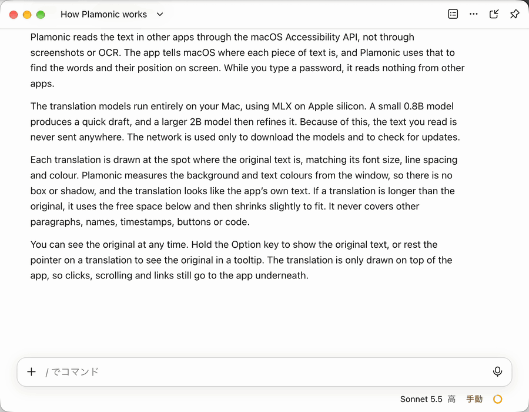

<div align="center">

# Plamonic

**Mac のアプリを、その場で日本語に。**

ほかのアプリの文章の上に訳文を重ねて、はじめから日本語で書かれていたように見せるメニューバーのアプリです。<br>
翻訳は PLaMo 3 Translate が Mac の中で行うので、読んだ文章は外に出ません。

[](https://github.com/sizumita/Plamonic/releases/latest)


[](LICENSE)

日本語 | [English](README.en.md)



</div>

## Plamonic でできること

### 原文の上になじむように重ねる

訳文は原文と同じ位置に、同じ文字の大きさ・行間・色で描きます。背景色と文字色はウインドウの画面から測るので、枠も影もなく、アプリ自身が表示しているように見えます。
訳文が長くなったときは、下の空きに行を足し、それでも入らなければ少しだけ縮めて収めます。ほかの段落や、名前・時刻・ボタン・コードには重ねません。

### いつもどおりに操作できる

訳文は表示のためだけに重ねているので、クリックやスクロールはそのままアプリに届きます。
訳文の中のリンクも押せます。右クリックすると、「リンクのアドレスをコピー」など、アプリ自身のメニューが出ます。

### 原文はいつでも見られる

⌥（Option）を押している間は原文に戻ります。訳文の上にポインタを止めると、原文を吹き出しで表示します。

### すべて Mac の中で

画面の文章は、スクリーンショットや OCR ではなく macOS のアクセシビリティ API でアプリから直接読み取ります。翻訳モデルは [MLX](https://github.com/ml-explore/mlx-swift) で Mac の上で動くので、文章がネットワークに送られることはありません。パスワードを入力している間は何も読み取りません。

### アプリに合わせて訳す部分を選ぶ

Slack や Discord ならメッセージの本文だけ、ターミナルなら罫線やプロンプトを除いた出力だけ、というように、アプリごとに訳す部分を決めています。
ウインドウ全体のほか、マウスの下の段落だけ、選択した文章だけ、と範囲を変えることもできます。

### そのほか

- 翻訳先は 53 の言語と、やさしい日本語から選べます。文体（常体・敬体）も選べます。
- 固有名詞や社内用語の訳し方を、用語集で決めておけます。
- アプリごとに「自動」（画面が変わるたびに訳す）・「手動」（ホットキーを押したときだけ訳す）・「オフ」を切り替えられます。
- 新しいバージョンが出るとメニューで知らせ、そのままアップデートできます。

## 対応アプリ

| | アプリ | 訳す部分 |
| :---: | --- | --- |
| ✅ | Slack | メッセージの本文 |
| ✅ | Discord | メッセージの本文と埋め込みの説明 |
| ✅ | Claude（Claude Code タブ） | チャットのメッセージ |
| ✅ | OpenCode（デスクトップ版） | 本文の段落 |
| ✅ | ターミナル（Terminal.app） | 出力（Claude Code / Codex / OpenCode の CLI など） |
| 🟡 | iTerm2 | 出力（ターミナルと同じ方式） |
| 🟡 | Codex（デスクトップ版） | チャットのメッセージ |
| 🟡 | DeepSeek Harness | チャットのメッセージ |
| ❌ | Ghostty | 訳せません（文字の位置を macOS に公開していないため） |

✅ 動作確認済み　🟡 設定は用意済み・未検証　❌ 非対応

一覧にないアプリでも、多くはそのまま使えます。はじめは手動で動くので、訳したいときに ⌃⌥R を押してください。訳す部分は「設定」>「アプリ」の「要素を調べる」で、マウスの下の要素から決められます。

## はじめかた

1. [最新のリリース](https://github.com/sizumita/Plamonic/releases/latest)から `Plamonic.dmg` をダウンロードし、Plamonic を「アプリケーション」フォルダにドラッグします。Developer ID で署名し、Apple の公証を受けているので、ふつうのアプリと同じように開けます。
2. Plamonic を開くと、メニューバーに吹き出しのアイコンが出ます（Dock には出ません）。
3. 案内に従って、「システム設定」>「プライバシーとセキュリティ」>「アクセシビリティ」で Plamonic をオンにします。再起動は要りません。
4. 同じウインドウからモデル（約 3.4 GB）をダウンロードします。終わるとすぐに翻訳が始まります。
5. 訳文を背景にもっとなじませたいときは、「画面収録を許可…」を押します（任意です）。

| 操作 | キー |
| --- | --- |
| 翻訳のオン・オフ | ⌃⌥T |
| 今すぐ翻訳する | ⌃⌥R |
| 原文を見る | ⌥ を押している間 |

設定の一つひとつや、うまく動かないときの確かめ方は[使い方](docs/USAGE.ja.md)にまとめています。

## 動作環境

- macOS 15 以降、Apple シリコン（M1 以降）の Mac
- メモリ: 0.8B / 2B モデルは 8 GB 以上、8B は 16 GB 以上、31B は 48 GB 以上
- ディスク: 既定のモデル（2B と、下書き用の 0.8B）で約 3.4 GB

## プライバシー

- 文章はアクセシビリティ API で読み取ります。スクリーンショットや OCR は使いません。
- 通信するのは、Hugging Face からモデルをダウンロードするときと、GitHub でアップデートを確認するときだけです。アップデートの確認で、使い方や Mac の情報は送りません。
- 画面収録の許可は任意です。許可すると、訳文を原文になじませるために文章のまわりの色を測ります。取り込んだ画面は色を測るためだけにメモリの中で使い、保存も送信もしません。
- パスワードを入力している間（パスワード欄、システムのパスワード画面）は、ほかのアプリの文章も画面も読み取りません。パスワード欄の中身はどんなときも読み取りません。
- 訳文のキャッシュは `~/Library/Application Support/Plamonic` に、自分だけが読める権限で保存します。保存しないようにもできます。

## よくある質問

<details>
<summary><b>無料で使えますか？</b></summary>

Plamonic は無料のオープンソースソフトウェア（AGPL-3.0）です。
翻訳モデルの PLaMo 3 Translate は Preferred Networks が [PLaMo Community License](https://plamo.preferredai.jp/info/plamo-community-license) のもとで公開しています。使う前にライセンスを確認してください。商用で利用する場合は Preferred Networks への登録が必要です。

</details>

<details>
<summary><b>日本語の文章まで訳されてしまいませんか？</b></summary>

翻訳先と同じ言語の文章は、既定では訳しません。日本語のチャットは日本語のまま残ります。

</details>

<details>
<summary><b>どのくらいメモリを使いますか？</b></summary>

既定の 2B と 0.8B のモデルなら、8 GB の Mac で動きます。しばらく（既定 15 分）翻訳しないと、モデルをメモリから解放します。解放までの時間は「設定」>「詳細」で変えられます。

</details>

<details>
<summary><b>アプリの画面は英語にできますか？</b></summary>

今は日本語だけです。翻訳先の言語は日本語以外も選べます。

</details>

## ベータ版

`main` ブランチが変わるたびに作るベータ版も受け取りたいときは、「設定」>「一般」>「アップデート」で「ベータ版を受け取る」をオンにしてください。ベータ版も同じアプリなので、設定とモデルはそのまま使えます。

## ソースからビルドする

Xcode 27 と [XcodeGen](https://github.com/yonaskolb/XcodeGen) が必要です。

```sh
git clone https://github.com/sizumita/Plamonic.git
cd Plamonic
xcodegen generate
xcodebuild -project Plamonic.xcodeproj -scheme Plamonic -configuration Debug \
  -derivedDataPath build/DD -destination 'platform=macOS,arch=arm64' build
open build/DD/Build/Products/Debug/Plamonic.app
```

<details>
<summary>ビルドし直すたびにアクセシビリティの許可が外れるとき</summary>

このビルドはアドホック署名なので、ビルドし直すたびに macOS がアクセシビリティの許可を忘れます。
開発用の証明書がある場合は `Config/Signing.local.xcconfig`（Git には含めません）に次のように書くと、許可が保たれます。

```
CODE_SIGN_STYLE = Manual
CODE_SIGN_IDENTITY = <証明書の名前または SHA-1>
DEVELOPMENT_TEAM = <チーム ID>
```

</details>

ソースからビルドしたアプリは自動でアップデートしません。テストやリリースの手順は [docs/DEVELOPMENT.md](docs/DEVELOPMENT.md)（英語）にあります。

## ドキュメント

- [docs/USAGE.ja.md](docs/USAGE.ja.md): 使い方
- [docs/DEVELOPMENT.md](docs/DEVELOPMENT.md): ビルド、テスト、リリースとアップデート（英語）
- [docs/DESIGN.md](docs/DESIGN.md): 設計
- [docs/AX_NOTES.md](docs/AX_NOTES.md): 対応アプリのアクセシビリティの構造

## 開発に参加する

不具合の報告やプルリクエストを歓迎します。[CONTRIBUTING.md](CONTRIBUTING.md) を見てください。
セキュリティの問題は、公開の Issue ではなく [SECURITY.md](SECURITY.md) の方法で知らせてください。

## ライセンス

Copyright (C) 2026 sizumita.

Plamonic は [GNU Affero General Public License v3.0 only](LICENSE)（`AGPL-3.0-only`）のもとで公開しているフリーソフトウェアです。
Plamonic に含まれる、またはビルドに使うサードパーティのコードは、それぞれのライセンスに従います。一覧は [THIRD_PARTY_NOTICES.md](THIRD_PARTY_NOTICES.md) にまとめています。

PlamoKit のうち PLaMo 3 Translate のモデルのリポジトリから移植した部分と、モデルで作ったテストデータには、PLaMo Community License（[日本語](LICENSES/PLaMo-Community-License.ja.txt)、[英語](LICENSES/PLaMo-Community-License.txt)）も適用されます。

PLaMo 3 Translate のモデルは Plamonic には含まれません。Plamonic は Hugging Face からモデルをダウンロードします。モデルは Preferred Networks が PLaMo Community License のもとで公開しています。

Built with PLaMo.
